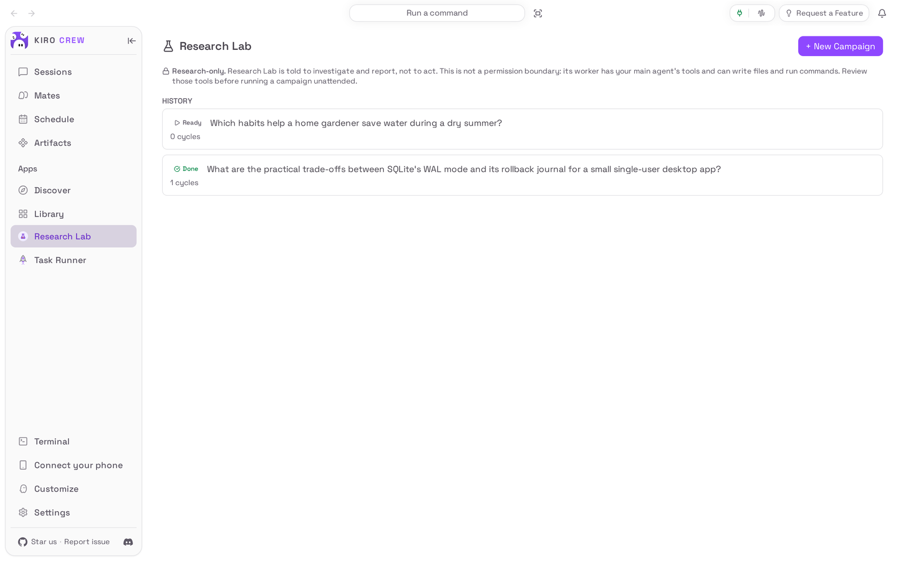

# Research Lab

<picture>
  <source media="(prefers-color-scheme: dark)" srcset="docs/media/hero-dark.png">
  
</picture>

**Hand a research question to an agent that keeps working, and come back to a report.**

Research Lab is an app for [Kiro Crew](https://github.com/kirodotdev/KiroCrew),
the open-source personal AI agent.

## What it is

Research Lab adds a **Research Lab** page to Kiro Crew. You give it a question
and, if you like, the narrower sub-questions you care about; it then runs a
**campaign**: a research agent works through the question in cycles, writes
what it found after every cycle, and stops by itself when your definition of
done is met, when it runs out of cycles, or when it stops making progress. The
findings appear on the page as they land, and the finished report can be sent
to your Knowledge Library or saved as a shareable artifact.

**Get started:** open **Apps → Library**, show the disabled apps, and choose
**Enable** on **Research Lab** (see [Install](#install)).

## The problem it solves

A question worth researching rarely fits in one chat turn. You ask, read the
answer, notice what it skipped, ask again, and an hour later the useful parts
are scattered across a conversation. Research Lab turns that loop into a
campaign that runs while you do something else: it keeps track of which
sub-questions are answered, writes each cycle's findings and sources down, and
checks its own work against the goal you set before it calls the job done.

It is told to research and report, not to act. It is not a permission boundary,
though: the research agent has the same tools your main agent has (see
[Settings & data](#settings--data)).

## Top 3 use cases

### 1. Turn a broad question into a plan

You run a small bakery and want to know how to plan oven time when weekend
orders double. In **+ New Campaign** you type the question and add the two
sub-questions that matter to you, one per line. **Grill me →** can also propose
sub-questions and clarifying questions for you to keep or prune. On the next
step you choose how many cycles it may use, how long it waits between them,
and what "done" means.


### 2. Let it research while you work, and see what it found

You are choosing how a small desktop app should store its data and want to
know whether SQLite's WAL mode is worth it. You start a campaign with two
sub-questions (what happens on a crash mid-write, and which mode is faster for
one user who mostly reads), tick **Run unattended**, and go back to your own
work. Each cycle the agent reads sources, writes a finding with its evidence
strength, and checks it against your **Definition of Done**. In the capture
below it needed three cycles of the five allowed, then marked **Goal met** and
stopped by itself.


### 3. Read the report and take it with you

When a campaign is done, **View report** shows what the agent wrote, split into
sections you can **Copy** one at a time into a chat or a document: what is
answered and how well, the weak spots it is aware of, and each cycle's notes
with links to the pages it read. **Export as Artifact** turns it into a
shareable report, **Add to Knowledge** puts it in your Knowledge Library, and
**Fork & Challenge** starts a follow-up campaign that questions these findings.


## Watch it


[Watch the walkthrough as a video (MP4)](docs/media/walkthrough.mp4).

<sub>Recorded from a real Kiro Crew (`99161724c0`, the App Kit level-1 commit, with only the built-in copy's registration removed) on a throwaway home, running this repository's own copy of the app. The campaign questions and sub-questions are made up and were entered through the app; the research, its findings and its report came from a live model with the research agent's real web reads, so they will differ on every run. Two waits for research cycles were shortened (about one and two and a half minutes). The sub-questions were typed by hand: the **Grill me** planner could not run on the capture machine.</sub>

## Install

**Today: Research Lab comes with Kiro Crew.** Nothing needs downloading. It
starts switched off:

1. In Kiro Crew, open **Apps → Library** in the left sidebar.
2. Choose **Show N disabled apps** (N is how many apps are switched off).
3. On the **Research Lab** tile, open the **⋯** menu and choose **Enable**.
4. **Research Lab** now appears under **Apps** in the sidebar.

The copy that comes with Kiro Crew and this repository's copy, pictured here,
look and behave the same; only where the campaign list is kept differs (see
[Settings & data](#settings--data) and [Development](#development)).

**Coming later: from the Kiro Crew App Store.** Once this app is listed there:

1. Open **Apps → Discover** in the left sidebar.
2. Search for **Research Lab** and choose **Install**.
3. Kiro Crew asks **Trust “Research Lab” to run its own code?** Research Lab
   runs a small program of its own inside Kiro Crew to keep your campaigns and
   to start and watch the research agent. Trusting it gives that program the
   same access Kiro Crew has (your files, your saved sign-ins and the
   internet), as the dialog says. If you are happy with that, choose **Trust
   this app**. You can take it back later in **Settings → Security →
   Third-party apps**.
4. The app installs switched off. Choose **Enable** on its page.

What you need: Kiro Crew on a Mac, Linux or Windows computer that can already
chat (if ordinary chats work, campaigns work). No accounts or keys are needed.

## First run

The page opens empty, with **Run autonomous research campaigns** and a
**+ New Campaign** button. Start with a question you would otherwise spend an
afternoon on, keep the cycle count low (the default suggestion is fine), and
tick **Run unattended (skip clarification questions)** if you will not be
around to answer the agent.

## How to use it

1. Choose **+ New Campaign**. Pick **Agent** (the agent decides each round) or
   **Dynamic Workflow** (it writes a plan up front and a runner follows it).
2. Type your question under **What do you want to research?** (at least 20
   characters). Add sub-questions in the box below it, pressing Enter after
   each, or choose **Grill me →** and keep the suggestions you like. Choose
   **Next →**.
3. Set **Max cycles**, **Idle between cycles** and, if you want the agent to
   check its work, a **Definition of Done**. Tick **Run unattended** to stop it
   pausing for questions. In Agent mode you can also pick the **Model**.
   Choose **Next →**.
4. Read the **Pre-flight Check** and choose **Start Campaign**. The campaign
   shows under **ACTIVE**; one campaign runs at a time.
5. Open it to watch. **Pause**, **Resume** and **Stop** do what they say.
   **Nudge** sends the agent a direction, and the box under
   **Sub-questions & guidance** adds a question mid-campaign (Agent mode only).
   If the agent needs a decision, the campaign shows **Agent needs input**:
   type your answer and choose **Answer & resume**.
6. When it is done, choose **View report**. **Export as Artifact** saves a
   shareable report, **Add to Knowledge** puts the findings in your Knowledge
   Library, and **Fork & Challenge** (under **Continue Research**) starts a
   follow-up campaign that builds on these findings.

## Settings & data

- **Where your data lives:** the campaign list and settings are in
  `~/.kiro/crew/apps/auto-research/data/campaigns.db` for this repository's
  copy, and in `~/.kiro/crew/apps/auto-research/campaigns.db` for the copy that
  comes with Kiro Crew today (this copy brings that file over the first time it
  opens, and leaves the original where it was). Each campaign's
  brief, findings and report are in
  `~/.kiro/crew/workspace/research/<campaign>/` (both under the folder you chose
  for Kiro Crew's data, if you moved it). Each campaign's research agent is a
  chat session of its own, kept with your other sessions.
- **What goes over the internet:** the research agent uses the same AI model as
  the rest of your Kiro Crew, and reads the web pages it decides to fetch, as
  your main agent would. Research Lab itself sends nothing anywhere. A report
  leaves your computer only if you share the artifact.
- **What the agent can do:** it is told to research and report, not to act,
  and Research Lab approves its tools for up to 24 hours per campaign so it can
  run unattended. Those are your main agent's tools, which can write files and
  run commands. Look at what your agent can do before running a campaign
  unattended.
- **Turn it off:** **Apps → Library**, open the **⋯** menu on Research Lab,
  choose **Disable**. A running campaign stops being driven and loses its tool
  approval; your campaigns are kept, and enabling the app again picks a running
  campaign back up.
- **Remove it** (once it is installed from the App Store): the same menu,
  **Uninstall**. **Keep app data** is ticked; untick it to delete the campaign
  list too. The research folders under `workspace/research/` are kept either way.
  The copy that comes with Kiro Crew can be switched off but not removed.

## Troubleshooting / FAQ

**The + New Campaign button is greyed out.**
Only one campaign runs at a time. Open the one under **ACTIVE** and **Pause**,
**Stop** or wait for it to finish.

**“Grill unavailable — add sub-questions manually below.”**
The question planner could not get an answer from the model in time. Type your
sub-questions in the box below instead, or try **Grill me →** again later; the
campaign itself does not need it.

**The campaign shows “Research Stalled” or “Failed”.**
The agent stopped producing findings for longer than the campaign allows, or it
kept failing to start. Your findings so far are kept. Choose **Resume** to try
again; if it happens repeatedly, check that an ordinary chat works.

**The campaign shows “Agent needs input”.**
The agent asked you a question. Type the answer and choose **Answer & resume**.
Tick **Run unattended** on the next campaign if you will not be around.

**A note says the model I picked is not available.**
Your account cannot use that model right now, so the campaign runs on the
default one. Pick another model next time, or leave **Default (inherit)**.

**After a day, the campaign says “Auto-approval expired after 24h. Resume to re-authorize and continue.”**
That is on purpose: the agent's tool approval lasts at most 24 hours per run.
Choose **Resume** to approve it again.

## Development

This repository is the externally packaged form of the `auto-research` app that
ships built into Kiro Crew. The two share a name, a version and the same
permissions, so a later Kiro Crew release can move an existing built-in install
onto this source in place, at a commit pinned in that release. Until a user's
Kiro Crew does that, it keeps running its built-in copy, and nothing here
changes what they run. [PORTING.md](PORTING.md) lists every place this copy
differs from the built-in and why, and what Kiro Crew must change first (gap 1:
the built-in's campaigns database is outside the folder an adoption keeps).

| Path | What it is |
|---|---|
| `app.json` | The app manifest, including the `ui` entry, the three `backend.hooks` and the `l10n` listing copy |
| `backend/handlers.py` | The 17 in-gateway routes, `on_startup` / `on_shutdown`, and the historic `handlers.<name>` facade |
| `backend/campaign/` | The campaign engine: storage, lifecycle, the agent and workflow modes, the watchdog, the planner, publication |
| `backend/_host.py`, `backend/_fs.py` | The only modules that touch the gateway (by name, through `importlib`) |
| `backend/_runtime.py` | State the three hooks share |
| `backend/_compat.py`, `_json.py` | Small helpers restated from Kiro Crew |
| `ui/src/` | The dashboard page (React), built against `@kirocrew/app-sdk` |
| `ui/i18n/` | The page's strings in every language the dashboard ships |
| `ui/dist/index.mjs` | The built page, **committed**: an install is a plain clone with no build step |
| `ui/tests/` | UI tests (vitest + jsdom), with light stand-ins for the host SDK |
| `assets/` | Store icon, hero art and screenshot (raster, as the catalog requires) |
| `tests/` | Backend and manifest tests, runnable offline with pytest |
| `capture/` | Captures the README media from a real, isolated Kiro Crew ([capture/README.md](capture/README.md)) |
| `docs/media/` | The README pictures and walkthrough, plus `media.json` (sizes, alt text, commits) |

### What it needs from Kiro Crew

Kiro Crew 0.13.0 or later (`minKiroCrewVersion`): App Kit level 1 structural
route records (a 0.12.x gateway skips them, so the app's API would answer 404
there), plus `ctx.scrub` (redaction of everything the agent wrote before it is
shown), `ctx.audit` (the security event log) and `ctx.http_app` (the dashboard
state the watchdog reads). A campaign also drives gateway services no App Kit
seam offers yet: the AutoNudge loop service, worker chat slots, Dynamic
Workflow runs, the Knowledge Library, the artifact store and the LLM pool.
`backend/_host.py` looks each up by name through `importlib`: services when an
operation calls for them, and a few constants and classes (such as the LLM pool
and the artifact store) once, when the hooks load. It refuses or degrades the
operation when one is missing, and `register_routes` reports what is missing
through the app's health. No other backend module but `_fs.py` names
`kiro_crew` (`tests/test_no_host_imports.py`).

### Install from a clone

```bash
git clone https://github.com/KiroCrewCaptain/kirocrew-app-auto-research
kirocrew app install ./kirocrew-app-auto-research
```

On a Kiro Crew that still ships the built-in, the install is refused
(`app 'auto-research' is already installed`). Elsewhere, turn it on from
**Apps → Library**: the app runs its own code (`backend.hooks` in `app.json`),
so **Enable** opens **Trust “Research Lab” to run its own code?**, and **Trust
this app and enable** does both. `kirocrew app enable auto-research` is refused
with `app_execution_denied` until the app is trusted.
`kirocrew app disable auto-research` turns it off;
`kirocrew app uninstall auto-research` keeps the data and adding
`--purge-data` deletes it.

### Tests

```bash
python -m pip install -r tests/requirements.txt   # includes a pinned Kiro Crew
python -m pytest
cd ui && npm ci && npm run typecheck && npm test && npm run build
git diff --exit-code -- dist                      # the committed bundle is the build
```

No test starts a model or opens a socket beyond loopback.

### Re-capture the README media

The pictures and the recording come from a real, isolated Kiro Crew gateway
driven by [`capture/`](capture/README.md), on a Kiro Crew tree with the
built-in's registration removed (capture/README.md says how). After any change
to what the app shows:

```bash
python capture/capture.py --kirocrew /path/to/KiroCrew
python capture/check_readme.py
```

Then look at every image and at a few frames of the video before committing
(see [CHECKLIST.md](CHECKLIST.md)).

## License

Apache License 2.0. See [LICENSE](LICENSE) and [NOTICE](NOTICE).
